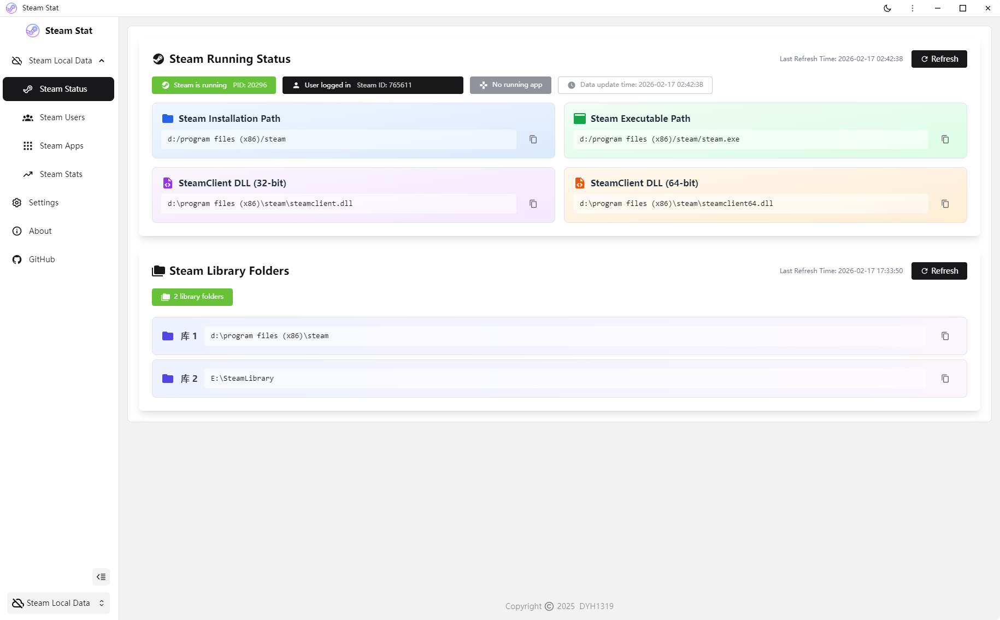
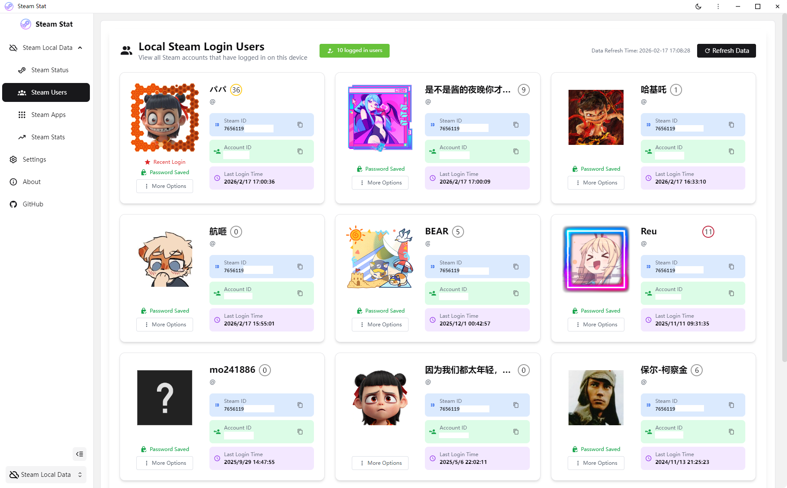
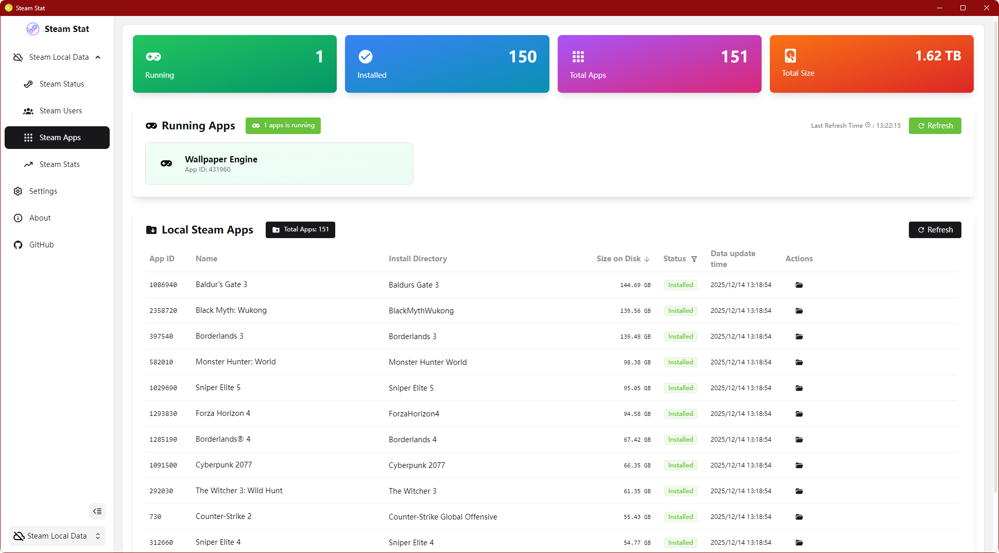
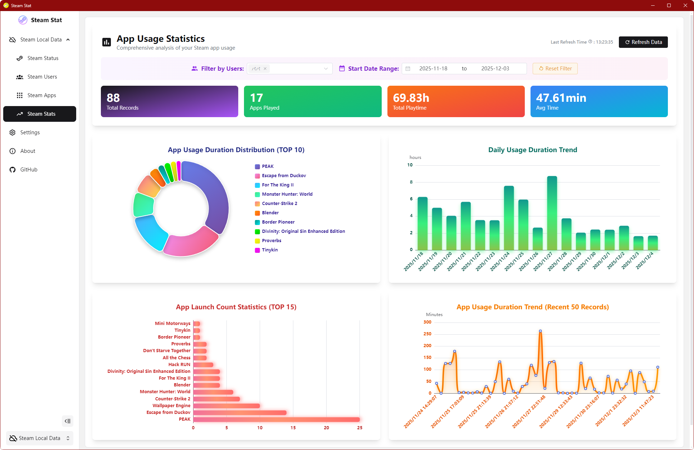

<p align="center">
  
</p>

<h1 align="center">Steam Stat</h1>

<p align="center"><b>Steam Game Statistics & Analytics Tool</b></p>

<p align="center">
  <a href="https://github.com/DYH1319/steam-stat/blob/master/LICENSE" target="_blank"></a>
  <a href="https://github.com/DYH1319/steam-stat/actions/workflows/ci.yml" target="_blank"></a>
  <a href="https://github.com/DYH1319/steam-stat/releases" target="_blank"></a>
  <a href="https://github.com/DYH1319/steam-stat/releases" target="_blank"></a>
</p>

---

## 🌍 Languages | 语言

**[简体中文](README.md)** | **English (Current)**

---

## 📖 Introduction

**Steam Stat** is a desktop app for Steam players (Windows / Linux / Steam Deck desktop mode). It records and analyzes what Steam itself doesn't keep: every play session, achievement unlock timelines, friend activity, and save and screenshot archives. Your data stays on your own computer.

### ✨ Why Choose Steam Stat?

- 🔒 **Local first**: Data stays on your machine. The author runs no server that stores your data, and there is no usage tracking
- 🕒 **Session-level records**: Automatically records when each play session starts and ends, and separates idle and foreground time
- 📊 **In-depth stats**: Heatmaps, timelines, yearly recaps, weekly and monthly reports, and personal records
- 🗂️ **Long-term archives**: Look back at achievements, friend activity, saves, screenshots and profile changes
- 🔄 **Your data is yours**: Export it, back it up, or sync it across devices with your own storage
- 🎨 **Customizable interface**: Adjust navigation modes, separate windows, theme colors, background images and fonts

### 🛡️ Data and Privacy

- Data is stored only in a local SQLite database by default
- The app connects to Steam services (sign-in, library, achievements, friends, store and images), and to GitHub and jsDelivr (update checks, public data and plugin downloads). These requests don't upload your play records
- Steam credentials are encrypted with system facilities (Windows DPAPI, Linux keyring) and are never included in manual backups or device sync
- Device sync is optional. Data is end-to-end encrypted before upload and only goes to storage you configure
- Crash reports are off by default. When enabled, redacted exception types, messages and stack traces, along with the app version and system information, are sent to Sentry to help fix problems

### 🔓 Open-Source Scope

This is Steam Stat's **backend repo** (the open data layer): all Steam local-file parsing, CM session management, usage tracking, SQLite storage, and IPC contracts — everything about "what is read and stored" is fully auditable.

The application UI (Vue renderer) lives in the private UI repo, built on a paid commercial component library. UI source of releases before `v2.0` remains available in this repository's history.

> The host and renderer communicate through a typed IPC contract (`backend/src/SteamStat.Contracts`), so it is technically possible to build your own frontend on top of this repo.

The five Steam Stat repositories:

| Name | Repository | Role |
|---|---|---|
| **Backend repo** | [`DYH1319/steam-stat`](https://github.com/DYH1319/steam-stat) | .NET host + Core + IPC contracts; Releases are the download page |
| **UI repo** | private | Vue renderer and release builds; references the backend repo as a submodule |
| **Electron.NET fork repo** | [`DYH1319/Electron.NET`](https://github.com/DYH1319/Electron.NET) | Patched Electron.NET fork, submodule `third_party/Electron.NET` of the backend repo |
| **Public data repo** | [`DYH1319/steam-stat-public-data`](https://github.com/DYH1319/steam-stat-public-data) | Game metadata and achievement schemas, downloaded by the host at runtime |
| **Plugin repo** | [`DYH1319/steam-stat-plugins`](https://github.com/DYH1319/steam-stat-plugins) | Save analysis plugins, installed by the host at runtime |

---

## 📦 Installation & Usage

### Download and Install

Download the latest version from the [Releases](https://github.com/DYH1319/steam-stat/releases) page:

| Platform | File | Notes |
| --- | --- | --- |
| Windows | `Steam-Stat-Setup-x.x.x.exe` | Installer with in-app updates |
| Windows | `Steam-Stat-Portable-x.x.x-win-x64.zip` | Portable, data is stored in `data/` next to the program |
| Linux / Steam Deck | `Steam-Stat-x.x.x-x86_64.AppImage` | Single file: make it executable and run, with in-app updates |
| Linux | `Steam-Stat-x.x.x-linux-x64.tar.gz` | Extract and run `steam-stat` |

Package manager manifests live in [`packaging/`](packaging/README.md) (available once published): `winget install DYH1319.SteamStat`, Scoop, Flathub and AUR `steam-stat-bin`.

Switch between the **Stable / Beta** update channels under App Updates in Settings. Beta gets new features earlier but may be less stable.

### System Requirements

- **Operating System**: Windows 10 / 11 (64-bit); Linux x86_64 (including Steam Deck desktop mode)
- **Steam**: Steam client must be installed (native, Flatpak and Snap Steam are supported on Linux)
- **Linux notes**: keeping Steam logins requires a system keyring (GNOME Keyring, KWallet or KeePassXC); AFK and foreground detection rely on X11 / XWayland; the AppImage needs FUSE 2

---

## 🚀 Main Features

- ✅ **Play Records**
  - Automatically detects running Steam games and records each session per account, with a detection interval of 1 to 60 seconds
  - Separates active play, idle and foreground time, and leaves out time the computer was asleep
  - Fills in session end times after the app exits unexpectedly
  - Search, edit, delete and merge sessions, and add notes and tags
  - Cleanup rules: ignore very short sessions, merge sessions close together, exclude specific apps
  - Import Steam's total playtime as a baseline or import from CSV, and reconcile with official playtime

- ✅ **Stats and Reports**
  - Yearly heatmap, daily rhythm heatmap, session timeline and game lifecycle curves
  - Period comparisons, personal records, and playtime by genre, developer, publisher and tag
  - Yearly recaps, weekly and monthly reports, on-this-day, and shareable images
  - Linked charts with drill-down, and dashboards you can rearrange and save as multiple layouts

- ✅ **Library**
  - Owned games, family sharing, wishlist, and locally installed apps with disk usage
  - Acquisition dates, backlog, cost per hour, game status and personal ratings
  - Cleanup suggestions for games you installed but don't play
  - Launch games, verify files and open store pages through Steam

- ✅ **Achievements**
  - Overview and per-game details, including hidden achievements, unlock times and global unlock rates
  - Cross-game timeline and calendar, rare achievement wall, perfect games and completion stats
  - Achievement target list, and which session each achievement was unlocked in

- ✅ **Friends**
  - Friends list, online status and current games
  - Choose which friends to track, and record changes to status, game and nickname
  - Friend profiles: daily rhythm heatmap, most played games, nickname history
  - Played-together stats, popular games among friends, and friends added or removed
  - Compare libraries and achievements with a friend

- ✅ **Archive**
  - Save backups: keeps version history, only reads save folders and never writes back (off by default)
  - Save analysis: detailed per-game reports through [plugins](https://github.com/DYH1319/steam-stat-plugins)
  - Screenshot archive: browse by game and date, linked to the session they were taken in
  - History of your own nickname, avatar, level and badges

- ✅ **Accounts**
  - Sign in with a password, QR code or saved credentials, with Steam Guard support and multiple accounts online at once
  - Quick switching between local accounts, with multiple online statuses

- ✅ **Data Management**
  - Export to CSV, Excel and full JSON
  - One-click backup and restore, with optional passphrase encryption
  - Device sync through a local folder, WebDAV or S3, end-to-end encrypted
  - Automatic backup before database migrations

- ✅ **Interface**
  - Overview dashboard and global timeline
  - Global search (Ctrl+K), customizable shortcuts and a background tasks panel
  - Three navigation modes, optional tabs, and separate windows for pages such as game details
  - Custom colors, background images, fonts and font size, comfortable / compact density, and Mica and Acrylic effects on Windows 11
  - Streamer mode and hidden games
  - Simplified Chinese and English, with light, dark and system themes

- ✅ **System Integration**
  - Tray shows the current game and today's playtime, with quick account switching
  - System notifications for reports, milestones and data source problems
  - Launch at startup, custom proxy, China network optimization and network diagnostics
  - In-app updates, and redacted diagnostic bundles for reporting problems

---

## 🎯 Future Plans

These are current plans only, with no guarantee they will all ship. They may change based on demand.

Suggestions are welcome in [Issues](https://github.com/DYH1319/steam-stat/issues).

- [ ] macOS version
- [ ] Database encryption: on hold until a suitable SQLCipher build is available

---

## 🧭 Scope and Non-goals

> **Steam Stat records and analyzes what Steam itself throws away — locally, on your machine.**

There is exactly one test for whether a feature belongs here: **does Steam keep this data?**

- What Steam **does not keep** — session-level playtime history, friend presence history,
  achievement unlock timelines, save-file progress — is where this project adds value
- What Steam **already shows** — library browsing, friends list, the store — will never be
  done better here than in the Steam client itself

### Explicit Non-goals

To keep a single-maintainer project sustainable, the following are out of scope and related
issues will be closed:

- ❌ **Not a Steam client replacement**: store, chat, download management, game launcher
- ❌ **No inventory / items / market price** features
- ❌ **Nothing that modifies Steam data**: editing saves, unlocking achievements, faking
  playtime, in-game injection (save-file features are **read-only**)
- ❌ **No server-side features that upload identifiable user data**. Device sync is end-to-end
  encrypted, unreadable by the server and entirely optional. You can use your own storage
  (a local folder / WebDAV / S3) or not sync at all
- ❌ **No monitoring of non-Steam games or other processes**
- ❌ **No intervention features**: playtime goals, anti-addiction limits, late-night reminders

---

## 📸 Screenshots

> These screenshots are from an early version. The current interface and menus have changed considerably.

<div align="center">

### Steam Status
<picture>
  <source media="(prefers-color-scheme: dark)" srcset="docs/screenshots/steam-status-en-US-dark.png">
  <source media="(prefers-color-scheme: light)" srcset="docs/screenshots/steam-status-en-US.png">
  
</picture>

### Steam User Information
<picture>
  <source media="(prefers-color-scheme: dark)" srcset="docs/screenshots/steam-user-en-US-dark.png">
  <source media="(prefers-color-scheme: light)" srcset="docs/screenshots/steam-user-en-US.png">
  
</picture>

### Steam App Information
<picture>
  <source media="(prefers-color-scheme: dark)" srcset="docs/screenshots/steam-app-en-US-dark.png">
  <source media="(prefers-color-scheme: light)" srcset="docs/screenshots/steam-app-en-US.png">
  
</picture>

### Steam Usage Statistics
<picture>
  <source media="(prefers-color-scheme: dark)" srcset="docs/screenshots/steam-usage-en-US-dark.png">
  <source media="(prefers-color-scheme: light)" srcset="docs/screenshots/steam-usage-en-US.png">
  
</picture>

</div>

---

## 🛠️ Technology Stack

### Backend (this repo)
- **[.NET 10](https://dotnet.microsoft.com/)** - Backend runtime
- **[Electron.NET](https://github.com/ElectronNET/Electron.NET)** - Desktop app framework based on Electron + .NET, using a [maintained fork](https://github.com/DYH1319/Electron.NET)
- **[Entity Framework Core](https://learn.microsoft.com/ef/core/)** + **[SQLite](https://www.sqlite.org/)** - Local data storage
- **[SteamKit2](https://github.com/SteamRE/SteamKit)** - C# Steam client API
- **[ValveKeyValue](https://github.com/ValveResourceFormat/ValveKeyValue)** - Valve KV format parser
- **[Serilog](https://serilog.net/)** - Logging
- **[electron-builder](https://www.electron.build/)** - Electron packaging tool

### Interface (UI repo)
- **[Vue 3](https://vuejs.org/)** + **[TypeScript](https://www.typescriptlang.org/)** + **[Vite](https://vitejs.dev/)**
- **[Fantastic-admin](https://fantastic-admin.hurui.me/)** - A Vue 3 based frontend framework
- **[Reka UI](https://reka-ui.com/)** - Unstyled component library
- **[UnoCSS](https://unocss.dev/)** - Instant atomic CSS engine
- **[ECharts](https://echarts.apache.org/)** - Data visualization library
- **[Pinia](https://pinia.vuejs.org/)**, **[VueUse](https://vueuse.org/)**, **[Day.js](https://day.js.org/)**
- **[Iconify](https://iconify.design/)** - Modern icon library
- **[Icon8](https://icon8.com/)** - Modern icon library, icons used in the project can NOT be redistributed.

---

## 🔧 Development Guide

This repo builds and tests on its own, without the interface code. All you need is the [.NET SDK](https://dotnet.microsoft.com/download) 10.0 or later, on Windows or Linux.

### Clone Repository

This project pulls in the Electron.NET fork repo as a git submodule. You **must clone with submodules**, otherwise the .NET project will not build:

```bash
git clone --recurse-submodules https://github.com/DYH1319/steam-stat.git
cd steam-stat

# If you already cloned without --recurse-submodules:
git submodule update --init --recursive
```

### Build and Test

```bash
dotnet restore SteamStat.slnx -p:ElectronSkipExecCommands=true
dotnet build SteamStat.slnx -p:ElectronSkipExecCommands=true
dotnet test SteamStat.slnx -p:ElectronSkipExecCommands=true
```

### IPC Contracts

Endpoints and DTOs live in `backend/src/SteamStat.Contracts`. After changing them, regenerate and commit the generated files:

```bash
dotnet run --project tools/GenerateIpcContracts -- --check   # Check whether generated files are up to date
dotnet run --project tools/GenerateIpcContracts -- --write   # Regenerate
```

### Database Migrations

```bash
cd ElectronNet/ElectronNet
dotnet ef migrations add <MigrationName>
```

The app applies migrations automatically on startup and backs up the database first.

### Running and Releases

The interface lives in the private UI repo, so you can't start the full app from this repo alone. Verify backend changes with tests. Release builds are produced by the UI repo's CI and published to this repo's [Releases](https://github.com/DYH1319/steam-stat/releases).

See [CONTRIBUTING.md](CONTRIBUTING.md) and [docs/ARCHITECTURE.md](docs/ARCHITECTURE.md) for more details.

---

## 🤝 Contributing

Issues and Pull Requests are welcome! This repo accepts contributions to backend logic, Steam integration, data storage and IPC contracts. For interface problems, open an Issue. Save analysis plugins go to the [plugin repo](https://github.com/DYH1319/steam-stat-plugins).

### Submit Issue

- 🐛 **Bug Report**: Describe the steps to reproduce the problem. The Feedback & Support page in the app can create an Issue with your environment filled in, and a redacted diagnostic bundle
- 💡 **Feature Request**: Describe the use case and expected behavior, and check the [non-goals](#explicit-non-goals) first
- ❓ **Questions**: Check the documentation and existing Issues first

### Submit Pull Request

1. Fork this repository
2. Create a branch from `develop` (`git checkout -b feature/AmazingFeature`)
3. Commit your changes (`git commit -m 'feat: add some amazing feature'`)
4. Push the branch (`git push origin feature/AmazingFeature`)
5. Open a Pull Request against `develop`

### Development Standards

- Follow [Conventional Commits](https://www.conventionalcommits.org/)
- Run `dotnet test` before committing, and commit generated files with contract changes
- Architecture boundaries are enforced by `SteamStat.Architecture.Tests`. Don't work around them
- Write a regression test first for new bugs

---

## 📄 License

This project is licensed under the **MIT License**.

For details, please see the [LICENSE](LICENSE) file.

### Copyright Notice

```
MIT License

Copyright (c) 2025-2026 DYH1319
```

---

## 🙏 Acknowledgments

Thanks to the following projects and communities:

- [Electron.NET](https://github.com/ElectronNET/Electron.NET) - Cross-platform desktop application framework based on Electron + .NET
- [SteamKit2](https://github.com/SteamRE/SteamKit) - C# Steam client API
- [Vue.js](https://vuejs.org/) - Elegant progressive framework
- [Fantastic-admin](https://fantastic-admin.hurui.me/) - A Vue 3 based frontend framework
- [Reka UI](https://reka-ui.com/) - Unstyled component library
- [ECharts](https://echarts.apache.org/) - Professional data visualization library
- [Entity Framework Core](https://learn.microsoft.com/ef/core/) - .NET official ORM framework
- [Icon8](https://icon8.com/) - Modern icon library, icons used in the project can NOT be redistributed.
- All developers who have contributed to this project

---

## 📬 Contact

- **Author**: DYH1319
- **GitHub**: [@DYH1319](https://github.com/DYH1319)
- **Issues**: [Submit Bug / Suggest Feature](https://github.com/DYH1319/steam-stat/issues)
- **Email**: [dyh@dyh1319.asia](mailto:dyh@dyh1319.asia)
- **Support the author**: [Afdian](https://afdian.com/a/DYH1319)
- **Other**: This is my first open source project. The original intention was to record my daily Steam usage and better manage my game time. I welcome criticism and correction from all experts. I also welcome improvement suggestions from everyone to improve this project together ❤️

---

## ⭐ Star History

If this project helps you, please give it a Star ⭐️!

<a href="https://www.star-history.com/#DYH1319/steam-stat&type=date&legend=top-left">
 <picture>
   <source media="(prefers-color-scheme: dark)" srcset="https://api.star-history.com/svg?repos=DYH1319/steam-stat&type=date&theme=dark&legend=top-left" />
   <source media="(prefers-color-scheme: light)" srcset="https://api.star-history.com/svg?repos=DYH1319/steam-stat&type=date&legend=top-left" />
   
 </picture>
</a>

---

<div align="center">

Translated by [Claude Opus 4.6 Thinking](https://claude.ai)
Made with ❤️ by DYH1319

</div>
