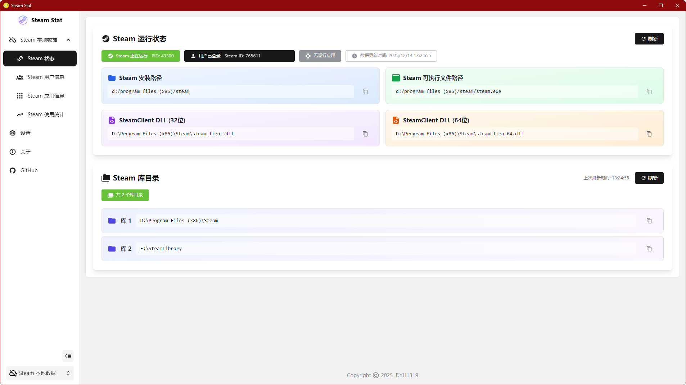
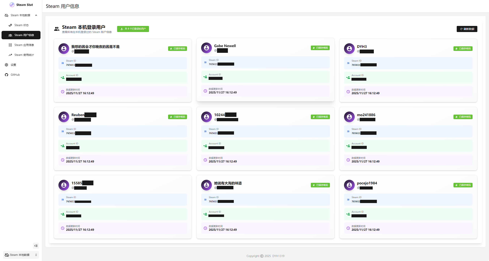
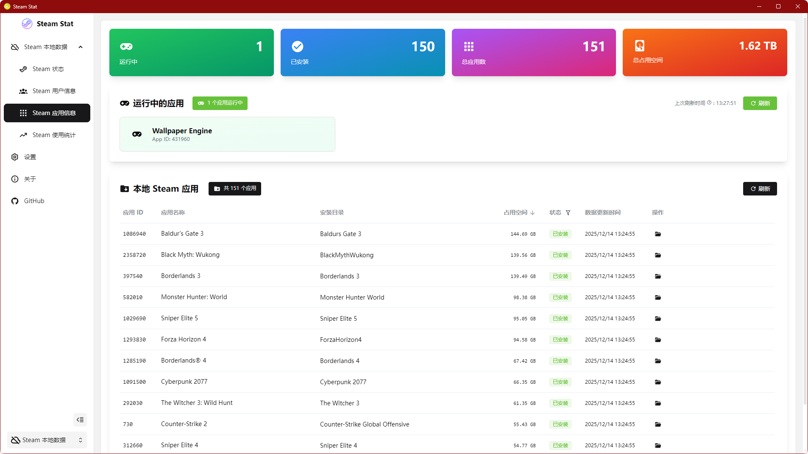
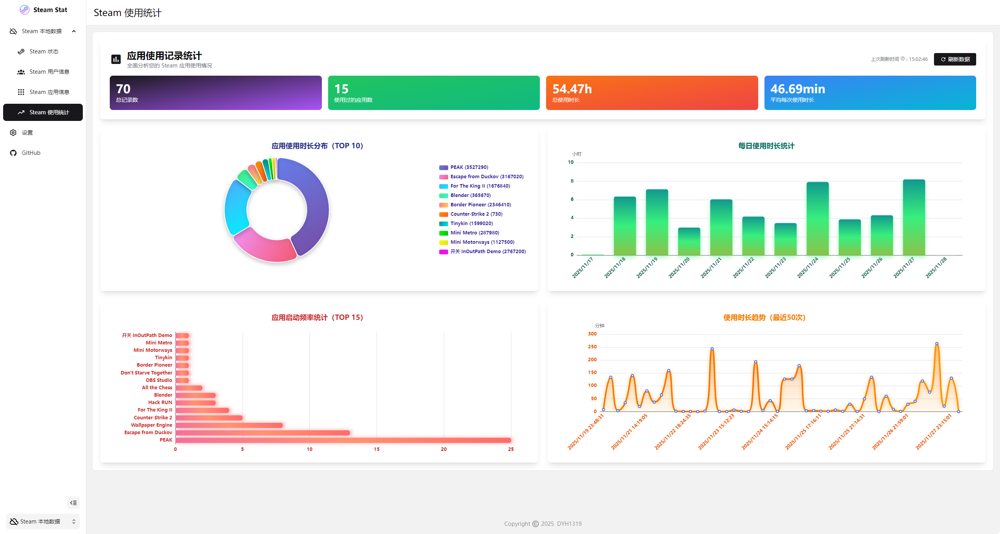

<p align="center">
  
</p>

<h1 align="center">Steam Stat</h1>

<p align="center"><b>Steam 游戏统计分析工具 | Steam Game Statistics & Analytics Tool</b></p>

<p align="center">
  <a href="https://github.com/DYH1319/steam-stat/blob/master/LICENSE" target="_blank"></a>
  <a href="https://github.com/DYH1319/steam-stat/actions/workflows/ci.yml" target="_blank"></a>
  <a href="https://github.com/DYH1319/steam-stat/releases" target="_blank"></a>
  <a href="https://github.com/DYH1319/steam-stat/releases" target="_blank"></a>
</p>

---

## 🌍 语言 | Languages

**简体中文 (当前)** | **[English](README.en-US.md)**

---

## 📖 项目简介

**Steam Stat** 是一款面向 Steam 玩家的桌面应用（Windows / Linux / Steam Deck 桌面模式），记录并分析 Steam 自己不保存的数据：每一次游玩会话、成就解锁时间线、好友状态变化、存档和截图档案。数据保存在你自己的电脑上。

### ✨ 为什么选择 Steam Stat？

- 🔒 **本地优先**：数据保存在本机，作者不运营任何保存你数据的服务器，也没有使用量统计
- 🕒 **会话级记录**：自动记录每次游玩的起止时间，区分挂机和前台时长
- 📊 **深入的统计**：热力图、时间轴、年度回顾、周报月报和个人纪录
- 🗂️ **长期档案**：成就、好友动态、存档、截图和资料变化都能回看
- 🔄 **数据归你所有**：可以导出、备份，也可以用自己的存储在多台设备间同步
- 🎨 **可定制的界面**：导航模式、独立窗口、主题色、背景图和字体都能调整

### 🛡️ 数据与隐私

- 数据默认只保存在本机的 SQLite 数据库中
- 应用会访问 Steam 的服务（登录、游戏库、成就、好友、商店和图片），以及 GitHub 和 jsDelivr（检查更新、下载公共数据和插件）。这些请求不会上传你的游玩记录
- Steam 登录凭证用系统能力加密保存（Windows DPAPI、Linux 密钥环），不会进入手动备份和多设备同步
- 多设备同步是可选功能，数据在上传前端到端加密，只写入你自己配置的存储
- 崩溃报告默认关闭。开启后，脱敏的异常类型、消息和堆栈，以及应用版本和系统信息，会上报到 Sentry，用于修复问题

### 🔓 开源范围

本仓库是 Steam Stat 的**后端仓**（开源数据层）：包含全部 Steam 本地文件解析、CM 会话管理、使用记录追踪、SQLite 存储与 IPC 契约——即"读了什么、存了什么"完全可审计。

应用界面（Vue 渲染层）在私有的 UI 仓，使用付费授权的商业组件库构建，不便公开源码。`v2.0` 之前的历史版本 UI 源码仍保留在本仓库的提交历史中。

> 后端与渲染层之间通过类型化 IPC 契约通信（`backend/src/SteamStat.Contracts`），理论上可以基于本仓库自行实现任何前端界面。

Steam Stat 相关的五个仓库：

| 称呼 | 仓库 | 说明 |
|---|---|---|
| **后端仓** | [`DYH1319/steam-stat`](https://github.com/DYH1319/steam-stat) | .NET Host + Core + IPC 契约；Releases 是下载入口 |
| **UI 仓** | 私有 | Vue 渲染层与发行构建，以 submodule 引用后端仓 |
| **Electron.NET fork 仓** | [`DYH1319/Electron.NET`](https://github.com/DYH1319/Electron.NET) | 自维护的 Electron.NET fork，后端仓 submodule `third_party/Electron.NET` |
| **公共数据仓** | [`DYH1319/steam-stat-public-data`](https://github.com/DYH1319/steam-stat-public-data) | 游戏元数据与成就 schema，Host 运行时下载 |
| **插件仓** | [`DYH1319/steam-stat-plugins`](https://github.com/DYH1319/steam-stat-plugins) | 存档分析插件，Host 运行时安装 |

---

## 📦 安装与使用

### 下载安装

前往 [Releases](https://github.com/DYH1319/steam-stat/releases) 页面下载最新版本：

| 平台 | 文件 | 说明 |
| --- | --- | --- |
| Windows | `Steam-Stat-Setup-x.x.x.exe` | 安装版，支持应用内自动更新 |
| Windows | `Steam-Stat-Portable-x.x.x-win-x64.zip` | 便携版，解压即用，数据保存在程序目录的 `data/` |
| Linux / Steam Deck | `Steam-Stat-x.x.x-x86_64.AppImage` | 单文件，添加可执行权限后直接运行，支持应用内自动更新 |
| Linux | `Steam-Stat-x.x.x-linux-x64.tar.gz` | 解压后运行 `steam-stat` |

也可以通过包管理器安装（清单见 [`packaging/`](packaging/README.md)，上架后可用）：`winget install DYH1319.SteamStat`、Scoop、Flathub、AUR `steam-stat-bin`。

在设置的「应用更新」里可以切换**稳定版 / 测试版**更新通道。测试版能更早用上新功能，但可能不够稳定。

### 系统要求

- **操作系统**：Windows 10 / 11 (64-bit)；Linux x86_64（含 Steam Deck 桌面模式）
- **Steam**：需要安装 Steam 客户端（Linux 支持原生、Flatpak 与 Snap 版 Steam）
- **Linux 额外说明**：保存 Steam 登录需要系统密钥环（GNOME Keyring、KWallet 或 KeePassXC）；挂机与前台检测依赖 X11 / XWayland；AppImage 需要 FUSE 2

---

## 🚀 主要功能

- ✅ **游玩记录**
  - 自动检测运行中的 Steam 游戏，按账号记录每次会话，检测间隔 1 ~ 60 秒可调
  - 区分有效游玩、挂机和前台时长，睡眠时段不计入
  - 应用异常退出后自动补全会话结束时间
  - 会话可以搜索、编辑、删除和合并，可以加备注和标签
  - 自动清洗规则：忽略过短的会话、合并间隔很短的会话、排除指定应用
  - 导入 Steam 累计时长作为基线，或从 CSV 导入，并和官方时长对账

- ✅ **统计与报告**
  - 年度热力图、作息热力图、会话时间轴、游戏生命周期曲线
  - 同比环比、个人纪录，按类型、开发商、发行商和标签汇总时长
  - 年度回顾、周报月报、历史上的今天，可以生成分享图
  - 图表联动和下钻，仪表盘可以自由调整并保存多套布局

- ✅ **游戏库**
  - 自有库、家庭共享库、愿望单，以及本机已安装的应用和磁盘占用
  - 入库时间、积压清单、每小时成本、游戏状态和个人评分
  - 「装了不玩」清理建议
  - 通过 Steam 启动游戏、验证完整性、打开商店页

- ✅ **成就**
  - 成就概览和单个游戏详情，包括隐藏成就、解锁时间和全球解锁率
  - 跨游戏时间线和日历、稀有成就墙、完美游戏和完成度统计
  - 成就目标清单，可以看到成就是在哪次会话中解锁的

- ✅ **好友**
  - 好友列表、在线状态和正在玩的游戏
  - 手动选择要追踪的好友，记录状态、游戏和昵称的变化
  - 好友档案：作息热力图、常玩游戏、昵称历史
  - 一起游玩统计、好友圈热门游戏、好友增删记录
  - 和好友对比游戏库与成就

- ✅ **档案**
  - 存档备份：保留版本历史，只读取存档目录，绝不写回（默认关闭）
  - 存档分析：通过[插件](https://github.com/DYH1319/steam-stat-plugins)生成单个游戏的详细报告
  - 截图档案：按游戏和日期浏览，并关联到当时的会话
  - 自己的昵称、头像、等级和徽章变化历史

- ✅ **账号**
  - 账号密码、扫码和已保存凭证三种登录方式，支持 Steam Guard，可以多账号同时在线
  - 本机账号快速切换，支持多种在线状态

- ✅ **数据管理**
  - 导出 CSV、Excel 和完整 JSON
  - 一键备份和恢复，备份可以用口令加密
  - 多设备同步：本地文件夹、WebDAV 或 S3，端到端加密
  - 数据库迁移前自动备份

- ✅ **界面**
  - 概览仪表盘和全局时间线
  - 全局搜索（Ctrl+K）、可自定义的快捷键、后台任务面板
  - 三种导航模式，可选多标签页，游戏详情等页面可以在独立窗口打开
  - 自由取色、自定义背景图、字体和字号、舒适 / 紧凑密度，Windows 11 支持云母和亚克力效果
  - 主播模式和隐藏指定游戏
  - 简体中文和英文，浅色、深色和跟随系统

- ✅ **系统集成**
  - 托盘显示当前游戏和今日时长，可以快速切换账号
  - 系统通知：报告生成、里程碑、数据源异常
  - 开机自启，自定义代理，国内网络优化，网络诊断
  - 应用内更新，生成脱敏的诊断包用于反馈问题

---

## 🎯 未来计划

只代表目前的计划，不保证都会实现，会根据需求进行增减。

如果有好的建议，欢迎在 [Issues](https://github.com/DYH1319/steam-stat/issues) 中提出。

- [ ] macOS 版本
- [ ] 数据库加密：目前暂缓，还没有合适的 SQLCipher 构建

---

## 🧭 项目定位与 Non-goals

> **Steam Stat 记录并分析 Steam 自己丢弃的数据 —— 全部在你自己的机器上。**

判断一个功能该不该做，只看一条：**Steam 自己保存这份数据吗？**

- Steam **不保存**的 —— 会话级游玩历史、好友在线状态历史、成就解锁时间线、存档进度 —— 这是本项目的价值所在
- Steam **已经展示**的 —— 库浏览、好友列表、商店 —— 做了也不会比 Steam 客户端更好

### 明确不做（Non-goals）

为了让单人维护的项目能长期活下去，以下方向明确不做，相关 Issue 会被关闭：

- ❌ **不做 Steam 客户端的替代品**：商店、聊天、下载管理、游戏启动器
- ❌ **不做库存 / 饰品 / 市场价格**相关功能
- ❌ **不做任何修改 Steam 数据的功能**：改存档、解锁成就、伪造游戏时长、游戏内注入
  （存档相关功能**只读**）
- ❌ **不做需要上传可识别用户数据的服务端功能**。多设备同步是端到端加密、服务端不可读、
  完全可选的；可以使用自带存储（本地文件夹 / WebDAV / S3），也可以完全不同步
- ❌ **不监测非 Steam 游戏或其他进程**
- ❌ **不做干预型功能**：时长目标、防沉迷、深夜提醒

---

## 📸 项目预览

> 截图来自早期版本，当前的界面和菜单已有较大变化。

<div align="center">

### Steam 状态
<picture>
  <source media="(prefers-color-scheme: dark)" srcset="docs/screenshots/steam-status-dark.png">
  <source media="(prefers-color-scheme: light)" srcset="docs/screenshots/steam-status.png">
  
</picture>

### Steam 用户信息
<picture>
  <source media="(prefers-color-scheme: dark)" srcset="docs/screenshots/steam-user-dark.png">
  <source media="(prefers-color-scheme: light)" srcset="docs/screenshots/steam-user.png">
  
</picture>

### Steam 应用信息
<picture>
  <source media="(prefers-color-scheme: dark)" srcset="docs/screenshots/steam-app-dark.png">
  <source media="(prefers-color-scheme: light)" srcset="docs/screenshots/steam-app.png">
  
</picture>

### Steam 使用统计
<picture>
  <source media="(prefers-color-scheme: dark)" srcset="docs/screenshots/steam-usage-dark.png">
  <source media="(prefers-color-scheme: light)" srcset="docs/screenshots/steam-usage.png">
  
</picture>

</div>

---

## 🛠️ 技术栈

### 后端（本仓库）
- **[.NET 10](https://dotnet.microsoft.com/)** - 后端运行时
- **[Electron.NET](https://github.com/ElectronNET/Electron.NET)** - 基于 Electron + .NET 的桌面应用框架，使用[自维护的 fork](https://github.com/DYH1319/Electron.NET)
- **[Entity Framework Core](https://learn.microsoft.com/ef/core/)** + **[SQLite](https://www.sqlite.org/)** - 本地数据存储
- **[SteamKit2](https://github.com/SteamRE/SteamKit)** - C# Steam 客户端 API
- **[ValveKeyValue](https://github.com/ValveResourceFormat/ValveKeyValue)** - Valve KV 格式解析器
- **[Serilog](https://serilog.net/)** - 日志
- **[electron-builder](https://www.electron.build/)** - Electron 应用打包工具

### 界面（UI 仓）
- **[Vue 3](https://vuejs.org/)** + **[TypeScript](https://www.typescriptlang.org/)** + **[Vite](https://vitejs.dev/)**
- **[Fantastic-admin](https://fantastic-admin.hurui.me/)** - 基于 Vue 3 的前端框架
- **[Reka UI](https://reka-ui.com/)** - 无样式组件库
- **[UnoCSS](https://unocss.dev/)** - 即时原子化 CSS 引擎
- **[ECharts](https://echarts.apache.org/)** - 数据可视化图表库
- **[Pinia](https://pinia.vuejs.org/)**、**[VueUse](https://vueuse.org/)**、**[Day.js](https://day.js.org/)**
- **[Iconify](https://iconify.design/)** - 现代图标库
- **[Icon8](https://icon8.com/)** - 现代图标库，项目中使用的图标不能进行二次分发，icons can NOT be redistributed.

---

## 🔧 开发指南

本仓库可以独立构建和测试，不需要界面代码。开发环境只需要 [.NET SDK](https://dotnet.microsoft.com/download) 10.0 或更高版本，Windows 和 Linux 都可以。

### 克隆项目

本项目通过 git submodule 引入 Electron.NET fork 仓，**必须带 submodule 克隆**，否则 .NET 项目无法构建：

```bash
git clone --recurse-submodules https://github.com/DYH1319/steam-stat.git
cd steam-stat

# 如果已经克隆过但忘了带 --recurse-submodules：
git submodule update --init --recursive
```

### 构建与测试

```bash
dotnet restore SteamStat.slnx -p:ElectronSkipExecCommands=true
dotnet build SteamStat.slnx -p:ElectronSkipExecCommands=true
dotnet test SteamStat.slnx -p:ElectronSkipExecCommands=true
```

### IPC 契约

端点和 DTO 在 `backend/src/SteamStat.Contracts`，修改后要重新生成并提交生成物：

```bash
dotnet run --project tools/GenerateIpcContracts -- --check   # 校验生成物是否过期
dotnet run --project tools/GenerateIpcContracts -- --write   # 重新生成
```

### 数据库迁移

```bash
cd ElectronNet/ElectronNet
dotnet ef migrations add <MigrationName>
```

应用启动时会自动执行迁移，迁移前会备份数据库。

### 运行与发行

界面在私有的 UI 仓，所以单独检出本仓库时无法启动完整应用，后端改动用测试验证即可。发行包由 UI 仓的 CI 构建，发布到本仓库的 [Releases](https://github.com/DYH1319/steam-stat/releases)。

更多细节见 [CONTRIBUTING.md](CONTRIBUTING.md) 与 [docs/ARCHITECTURE.md](docs/ARCHITECTURE.md)。

---

## 🤝 贡献指南

欢迎提交 Issue 和 Pull Request！本仓库接受后端逻辑、Steam 接入、数据存储和 IPC 契约相关的贡献。界面问题可以提 Issue，存档分析插件请提交到[插件仓](https://github.com/DYH1319/steam-stat-plugins)。

### 提交 Issue

- 🐛 **Bug 反馈**：请详细描述问题复现步骤。应用内的「反馈与支持」页可以生成预填运行环境的 Issue 和脱敏的诊断包
- 💡 **功能建议**：请说明功能的使用场景和期望效果，并先看一下[明确不做的方向](#明确不做non-goals)
- ❓ **问题求助**：请先查看文档和已有 Issue

### 提交 Pull Request

1. Fork 本仓库
2. 基于 `develop` 创建分支 (`git checkout -b feature/AmazingFeature`)
3. 提交更改 (`git commit -m 'feat: add some amazing feature'`)
4. 推送到分支 (`git push origin feature/AmazingFeature`)
5. 向 `develop` 开启 Pull Request

### 开发规范

- 遵循 [Conventional Commits](https://www.conventionalcommits.org/) 规范
- 提交前运行 `dotnet test`，契约变更要一起提交生成物
- 架构边界由 `SteamStat.Architecture.Tests` 强制，不要绕过
- 新缺陷优先写回归测试

---

## 📄 许可证

本项目采用 **MIT** 许可证。

详细信息请查看 [LICENSE](LICENSE) 文件。

### 版权声明

```
MIT License

Copyright (c) 2025-2026 DYH1319
```

---

## 🙏 致谢

感谢以下项目和社区：

- [Electron.NET](https://github.com/ElectronNET/Electron.NET) - 基于 Electron + .NET 的跨平台桌面应用框架
- [SteamKit2](https://github.com/SteamRE/SteamKit) - C# Steam 客户端 API
- [Vue.js](https://vuejs.org/) - 优雅的渐进式框架
- [Fantastic-admin](https://fantastic-admin.hurui.me/) - 基于 Vue 3 的前端框架
- [Reka UI](https://reka-ui.com/) - 无样式组件库
- [ECharts](https://echarts.apache.org/) - 专业的数据可视化库
- [Entity Framework Core](https://learn.microsoft.com/ef/core/) - .NET 官方 ORM 框架
- [Icon8](https://icon8.com/) - Icon8 现代图标库，项目中使用的图标不能进行二次分发，icons can NOT be redistributed.
- 所有为本项目做出贡献的开发者

---

## 📬 关于

- **作者**：DYH1319
- **GitHub**：[@DYH1319](https://github.com/DYH1319)
- **Issues**：[提交 BUG / 提出建议](https://github.com/DYH1319/steam-stat/issues)
- **Email**：[dyh@dyh1319.asia](mailto:dyh@dyh1319.asia)
- **支持作者**：[爱发电](https://afdian.com/a/DYH1319)
- **Other**：这是我的第一个开源项目，初衷是想记录自己的每天使用 Steam 的情况，更好的管理自己的游戏时间；本人技术有限，欢迎各位大佬批评指正；也欢迎各位大佬提出改进建议，一起完善这个项目 ❤️

---

## ⭐ Star History

如果这个项目对您有帮助，请给个 Star ⭐️ 支持一下！

<a href="https://www.star-history.com/#DYH1319/steam-stat&type=date&legend=top-left">
 <picture>
   <source media="(prefers-color-scheme: dark)" srcset="https://api.star-history.com/svg?repos=DYH1319/steam-stat&type=date&theme=dark&legend=top-left" />
   <source media="(prefers-color-scheme: light)" srcset="https://api.star-history.com/svg?repos=DYH1319/steam-stat&type=date&legend=top-left" />
   
 </picture>
</a>

---

<div align="center">

Made with ❤️ by DYH1319

</div>
